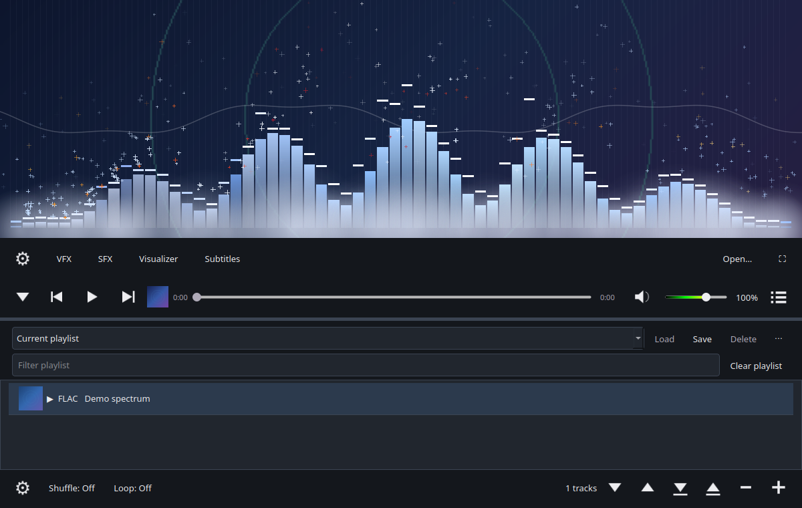

# FireMedia

A native audio and video player built with **Qt 6 / PyQt6 and libmpv**, featuring
music fireworks, physics-driven visualizers, art subtitles, and playlist management.
FFmpeg supplies audio samples for visualization; NumPy computes the spectrum.

Linux is tested. Windows portable/installer builds are prepared for Windows
validation, and Flathub support is planned. Media fills the window, with a
collapsible effects row and a resizable playlist drawer below the controls.



## Run

For an installed app with an application-menu entry, build the Debian/Ubuntu package with `python3 packaging/linux/build-deb.py`, then install `dist/firemedia_0.2.0_all.deb` using APT. Windows portable-app and installer recipes are included. See [desktop packaging instructions](packaging/README.md).

With the required dependencies installed:

```sh
./run.sh
./run.sh --fullscreen
./run.sh /path/to/song.flac /path/to/mix.m3u8
./run.sh 'https://your-server.example/live.m3u8'
```

For another Linux machine, install Python 3.10+, PyQt6, NumPy, libmpv, FFmpeg, libseccomp2 (for restricted mods), and Qt's XCB platform dependencies through its package manager. Alternatively install the Python package in a virtual environment with `pip install .`; libmpv and FFmpeg still need system installation. The `firemedia` command is created when installing the package. `firemedia.desktop` is included for desktop integration; use the supplied SVG as the `firemedia` desktop icon when installing that entry.

Video uses libmpv's OpenGL render API inside a Qt QOpenGLWidget in the same media area as the visualizer. It never asks mpv to create a separate window. The launcher honors Qt's normal platform selection and supports native Wayland and X11; it no longer forces XWayland. A working desktop OpenGL context is required.

## Development and releases

Development: [contributing](CONTRIBUTING.md), [security reporting](SECURITY.md),
[changelog](CHANGELOG.md), and [GitHub/release guide](docs/RELEASING.md).
CI tests Linux changes; manual/tag builds also prepare Windows packages and
versioned draft releases with source and checksums.

Automatic updates are **planned, not enabled**. The [update design](docs/UPDATES.md)
records four Windows installer modes, portable notifications, native Windows
notifications, and Linux notifications with updates through Flathub/the software
manager. [Flathub packaging](packaging/flatpak/README.md) is being prepared;
there is no published Flatpak listing yet.

## Controls and layout

- **Closed panels:** controls overlay the media. They are translucent over audio and invisible over video until the cursor enters the bottom 120 pixels. Opening either panel restores solid controls in the layout.
- **Bottom-left arrow:** show/hide Settings, VFX, SFX, Visualizer, Subtitles, Open, and Fullscreen.
- **Bottom-right playlist button:** show/hide the bottom drawer. Drag the splitter to resize it.
- **Six drawer buttons, left to right:** move down, move up, save playlist, load playlist, remove songs, add songs. Their tooltips and accessible names describe each action. Songs can also be dragged to reorder.
- **Playlist collection:** use Save to save or overwrite a named playlist, select its name and press Load to restore it, or Delete to remove the saved list. The ⋯ menu also offers Update selected app playlist and Rename. Clear playlist empties the queue and stops playback. Saving/deleting a named list and clearing the queue are separate actions. Filter entries or export M3U/M3U8. Queue removal does not delete files.
- **Shuffle:** Off (sequential), On (one shuffled order reused on repeat), Every loop (reshuffle each pass). **Loop:** Off, Playlist, Track. Automatic playback stops after the final song when Loop is Off, including with shuffle.
- **Ctrl+O:** open files or playlists. **Ctrl+L:** open HTTP(S) stream. **Ctrl+S:** export with full paths. **Ctrl+Shift+S** or **Shift+click Save:** export with relative paths. **Ctrl+P:** playlist drawer. **Ctrl+,**: settings. **Space:** play/pause. **F11/double-click media:** fullscreen. **Escape:** leave fullscreen or collapse a panel. **Delete/Enter in the queue:** remove/play.

## KDE media controls

FireMedia publishes the standard MPRIS2 interface over the login session's D-Bus using Qt D-Bus. KDE's Media Player widget and keyboard/headset media controls can pause/resume, change tracks, seek, and adjust volume while another application is focused. It publishes playback state, track title, duration, repeat/shuffle settings, and stable track IDs. The service is `org.mpris.MediaPlayer2.FireMedia` (with a unique suffix for additional running instances), and is removed when the window closes. No system-wide key grabbing or KDE shortcut changes are needed. The player must run in the normal graphical login session with its session bus available.

To test the actual D-Bus interface without controlling your desktop's active players:

```sh
QT_QPA_PLATFORM=offscreen FIREMEDIA_TEST_DBUS=1 dbus-run-session -- python3 -m unittest discover -s tests -p test_mpris.py -v
```

## Playback, playlists, and effects

libmpv handles decoding, hardware video acceleration, network streams, external and embedded subtitles, EQ, volume, and video picture adjustments. Actual format/device support depends on the installed libmpv/FFmpeg build; “universal” is the goal rather than a promise that every file decodes.

M3U and UTF-8 M3U8 track playlists resolve paths relative to their playlist file, preserve EXTINF names/durations, support HTTP(S) entries, and bound nested-playlist cycles. A local HLS manifest is passed to libmpv as **one stream**, preserving segment paths and variant selection. Remote HTTP(S) M3U8 sources are also delegated to libmpv. Normal Save exports UTF-8 with full local paths. Hold Shift while clicking the Save icon (or use Ctrl+Shift+S) to write paths relative to the destination playlist file. Local references in imported playlists are resolved against each playlist’s own directory into full paths, not against FireMedia’s working directory. Dragging M3U/M3U8 files into the window or playlist drawer appends their entries in order and preserves current playback. The Load file button replaces the queue. Dragging multiple playlists concatenates them.

The volume slider supports 0–150%, including amplification above 100%. The six-band EQ applies real audio filters inside libmpv. VFX offers brightness, contrast, saturation, and gamma. Opening VFX captures a still image. Slider edits preview locally on a bounded-size image instead of repeatedly reconfiguring the playing video. Apply submits the final adjustments asynchronously, holds the preview while the backend applies them, and releases it only after two new rendered frames. Audio/playback time continues during image hold. The CPU still preview approximates the picture adjustments; the applied result uses libmpv's actual renderer.

### Art subtitle presets

The subtitle dialog uses **Preset** with built-in Glow, Cinema, and Clean presets and a **Customize…** editor. Custom presets store art font, size, delay, particles, text color, gradient toggle/end color, stroke color, and stroke width. The editor supports Save as, Update, Rename, Remove, and import/export; the Preset row's ⋯ menu provides the same library actions. Built-ins remain available and are not overwritten or deleted.

Subtitles are painted as a native transparent Qt overlay on the video/visualizer, allowing gradients, outlines, and optional sparks. Subtitle sparks are disabled in LDM. The overlay uses decoded plain subtitle text; original ASS positioning, karaoke, and bitmap subtitle artwork are not reproduced by this custom text renderer. Font names are portable settings, but the font must be installed on the destination system to reproduce its appearance.

By default, local videos look for a sibling SRT with the same base name (case-insensitive). If no name matches and exactly one SRT is present, it is used; ambiguous directories are left alone. Disable **Automatically load SRT files beside videos** in Settings to turn this off. Embedded subtitle tracks and manual file loading remain available.

### Portable preset and app-playlist files

- **`.firemsub`** stores one named subtitle preset. Import/export is available in the Preset ⋯ menu and Customize. Importing a duplicate name creates a numbered copy.
- **`.firempl`** stores a named app playlist with each track's source and display title. Duration is omitted; older files containing duration still load. Use the playlist drawer's **⋯ → Import app playlist** / **Export app playlist**. Imports add to the saved playlist library and select the new list without replacing the playing queue; press Load to restore it. Existing names receive a numbered suffix.

Right-click a track and choose **Rename track…**, or select it and press **F2**, to change its display title without renaming the media file. The queue remembers edits across restarts, and M3U8 exports preserve them. Use **Save** or **⋯ → Update selected app playlist** to store edits in a named playlist before exporting that saved list.

Both formats are versioned, validated UTF-8 JSON. They contain settings or references, not media, fonts, or executable code. App playlist exports use full paths; relative references in imported `.firempl` files resolve from that file's directory. M3U/M3U8 exports and Shift+Save retain their existing behavior.

The audio visualizer decodes ahead on a background worker and keeps a bounded queue of timestamped FFT frames. Each animation frame selects spectrum data using libmpv's playback position, dropping superseded frames instead of replaying a delayed backlog. Pauses freeze the analysis clock; seeks replace the decoder and discard old frames. FFT band pooling is vectorized, and bar brushes, background trails, and transport icons are cached. The UI never waits for decoder shutdown.

Analysis still uses a second FFmpeg decode of the current source (including a second connection for remote audio), rather than tapping libmpv's PCM directly. Remote live streams may have differing stream origins; hardware output latency and FFT windowing can also affect perceived alignment. Video playback skips this separate analysis.

### Independent cap physics

Bar count is customizable from 8 to 256 in the Visualizer menu and is saved between sessions. Columns jump immediately to rising audio levels. Only falling levels are smoothed; disable “Smooth falling bars” for direct response in both directions. “Fall speed” controls the release rate. Barline caps have separate position/velocity, configurable spring/gravity, bounce and true-peak modes. Physics advances in small substeps to stay stable at both frame rates. Host particles remain capped at 400. The analyzer keys workers by media generation and bar count, and automatically retries stalled/failed startup without requiring a pause/resume. Valid silence is not treated as failure.

### Visualizer presets, images, and backgrounds

The Visualizer editor replaces the old effect choices with **Default, Classic, Frost, Amethyst, Ember, and Starry**. Default rotates its horizontal gradient at 36°/s. Starry adds blue bars and a partial-white collision flash. Edit horizontal/vertical RGBA gradients, bar/barline dimensions and collision fades, physics, and ranged particle motion/fade settings. Backgrounds support Off, Color, Gradient, Image, and song-cover artwork with transparency. Native cover discovery looks for `cover.*` beside local tracks, asynchronously supplies queue/transport icons, and supports optional codecs through Qt or FFmpeg. The waveform draws a thin trace of actual PCM audio between the background and bars (default solid `#FFFFFF33`), with adjustable time window, height, position, and width. Collision fog uses a separate 96-puff pool, while up to four independent regular particle channels share the 400-particle cap. All speed-controlled gradients have size multipliers, and barline launch height is directly adjustable in pixels. Bar, barline, particle, and background images are embedded in presets; crop, grid slice, repeat, and Fit/Scale/Stretch are supported. Save/update/rename/remove custom presets and import/export `.firemv` data files. See the [visualizer guide and complete setting reference](docs/VISUALIZER.md).

### Script plugins

**Settings → Manage plugins…** installs `.firemp` ZIP script packages, disabled until explicitly enabled. Mods execute in separate Linux workers with a default-deny seccomp policy: no host files, networking, or shell/subprocess execution. Only packaged assets, event data, and validated drawing/particle requests cross the boundary. Execution fails closed when restriction support is unavailable; Windows mod execution is disabled. The manager supports enable/disable/remove and logs, with timeouts for stuck workers. Enabled hashes are remembered; changed packages require enabling again. Previously unrestricted plugins require re-enabling under the new runner. See the [plugin API documentation](docs/PLUGINS.md). Build the editable Orbit Stars example with `python3 tools/build_plugins.py`, then install `dist/plugins/orbit-stars.firemp` and select its renderer.

Click anywhere on the seek scrubber to jump directly to that time; handle dragging and keyboard seeking remain available. Scrubber widget backgrounds are transparent. Volume clips one fixed black → green (50%) → yellow (100%) → red (150%) gradient, leaving the remaining range gray.

### Themes and settings

Both gear buttons open the same Settings menu. Its Themes submenu supports Simple hue/shade and light/dark controls, editable color palettes, and Advanced editing of each palette group, separate surface appearances, and fonts. Native tabs, scroll pages, tables, and checkboxes follow light/dark colors consistently. Named themes save/load/remove locally and import/export as `.firemt` with embedded image data. See the [theme, cover-art, and control guide](docs/THEMES.md).

### Low Detail Mode

| Mode | Behavior |
| --- | --- |
| Auto | Follow `power-saver` from Linux power-profiles-daemon, using its current or legacy D-Bus interface. If unavailable, use full detail. |
| On | Cap your chosen count at 24 bars, no regular particles or fog, and a 30 fps target. Hide/stop visualization and stop the extra analysis decode while the app is unfocused. Playback continues. |
| Off | Force full detail: your chosen bar count, particles, 60 fps target. |

Auto uses the same reduced behavior as On when power saving is active. Minimizing or hiding the window stops visualizer physics, particles, fog, mod animation frames, subtitle sparks, animated theme timers, and the extra audio-analysis decoder in **every LDM mode**, including Off. Playback and desktop media controls continue. Restoring resumes analysis at the current playback position. Video mode also suspends the audio visualizer. Resizing the visualizer clears particles/fog and resets bar physics so old screen coordinates cannot drift away from the bars; stale mod frames are discarded. No system power setting is changed.

Queue, named playlists, and settings are atomically stored in Qt's application-data location (typically `~/.local/share/FireMedia/FireMedia/state.json`). Files stay in their original locations. Use `--state /path/to/state.json` for a separate session. Original media files remain necessary; the player does not import copies into its storage.

## Logo

Runtime logo assets are included in `firemedia/assets/` and used for the window,
application-menu entry, and Windows packages. Editable artwork in the local
`art/` directory is excluded from the public repository.

## Verification

```sh
QT_QPA_PLATFORM=offscreen python3 -m unittest discover -s tests -v
```

Tests cover actual libmpv audio decoding, FFmpeg spectrum input, EQ filters, seeking, drag/drop, layout toggles, queue reorder, saved state, LDM focus behavior, UTF-8/relative/nested playlists, finite shuffle passes, and independent cap gravity/rebounds. A generated local HLS stream was also decoded successfully with one queue entry. No external media is bundled.

For a real desktop rendering check with generated clips (including non-black framebuffer pixels, audio/video switching, fullscreen, drawer resizing, and control opacity):

```sh
QT_QPA_PLATFORM=wayland dbus-run-session -- python3 tools/verify_video.py
# Use QT_QPA_PLATFORM=xcb to check X11 instead.
```

The earlier browser experiment is archived in `legacy/web-prototype/` and is not used by the native application. New native code is GPL-3.0-or-later, matching the open-source use of PyQt6; the archived experiment retains its MIT license. Check dependency licenses when distributing binaries.

References: [Qt widgets](https://doc.qt.io/qt-6/qtwidgets-index.html), [mpv manual](https://mpv.io/manual/stable/), [Power Profiles D-Bus](https://upower.pages.freedesktop.org/power-profiles-daemon/gdbus-org.freedesktop.UPower.PowerProfiles.html), [Elisa source](https://invent.kde.org/multimedia/elisa). No upstream player code or ACG graphics are copied into FireMedia.
